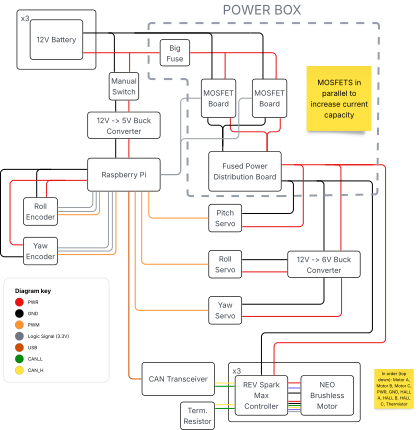
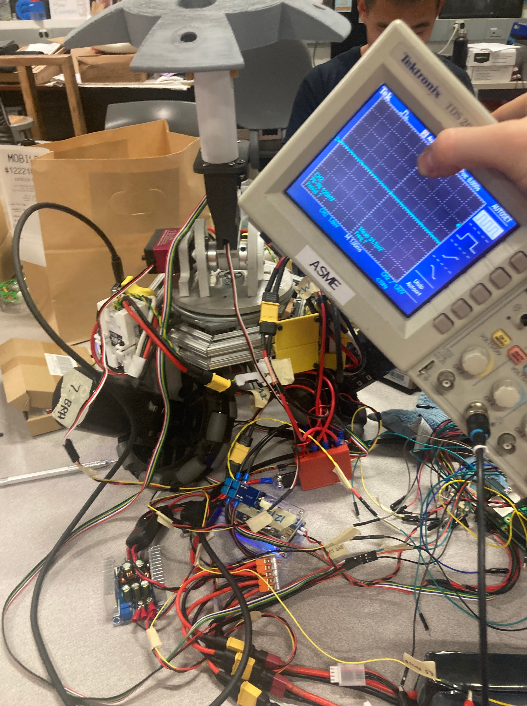

The ASME club at UCLA does a bunch of projects fun every year, one of which was a non-copyright-specific spherical robot with a dome shaped head. I joined the power systems team and helped out designing and building the electronics inside the body and head. The robot has two separate power systems: one inside the head powering the sensing and compute, and the other inside the body powering the drivetrain, which moves the spherical shell by driving up the side to shift its center of mass like a hamster ball. The body portion of the robot attaches to the head via a magnetic coupling on the end of a motorized arm so the head can turn and emote.

{: width="35%" .align-left}
We started from a handful of performance targets including robot weight, runtime, size, and speed, and used them to specify motors and batteries for the drivetrain. I helped find resources allowing the undergrad members model performance of some of our motor options based on available voltage and torque constants, and later to check their calculations for the rest of the motors in the arm. We also put together a couple wiring diagrams to make sure interfaces were clear for the mechanical and controls teams. One thing I'd probably change in hindsight was our use of MOSFETs as a watchdog controlled emergency stop, since we had one of them fail closed/short on one occasion. The brushless motor controllers that we chose also ended up being a bit annoying because their CAN protocol was not documented.

{: width="25%" .align-right}
Once we moved into the building and testing phase I helped out pretty extensively with verifying connections to avoid damaging components, and also mapping out GPIO connections alongside the controls team. We had a few issues getting reliable PWM signals out of a Raspberry Pi and had to rely extensively on scoping pins to see where there were loose jumpers, inaccurately timed signals, or disconnected grounds. 

