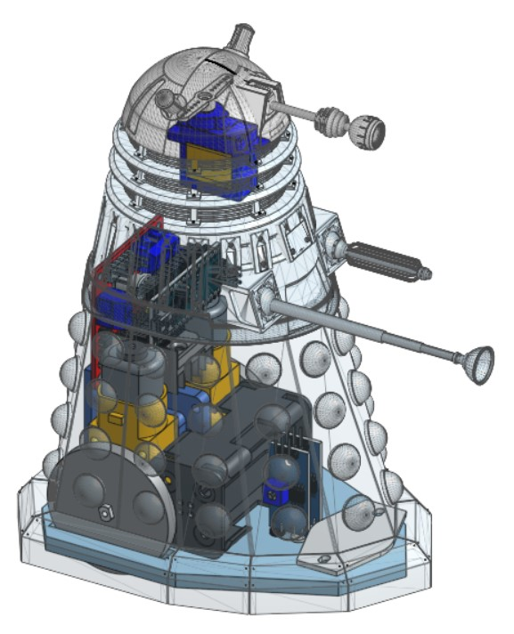

To introduce new Wisconsin Robotics Outreach members to mechatronics concepts and prototyping tools I prepared a set of lesson plans for building a simple line following robot during our first couple weeks, then built my own as an example. To guide the students through the project I structured the curriculum around teaching a lesson or two each on CAD, circuits, and programming. We did some hands-on breadboarding and introduced everyone to the team's 3D printing workflow so they could test out their parts.

{: width="30%" .align-right}
I built a simple example using the same components and stuffed it inside of a shell shaped like a Dalek, one of the most iconic Doctor Who villains. In addition to my being a big fan of the show at the time, it also seemed appropriate because Daleks were common sight at Milwaukee Maker Faire, one of the bigger events for the Outreach team. When building my own robot I limited myself to about 6 hours of design and build time near the end of my summer break, a bunch of which I spent trying to clean up different Dalek models from the internet to fit all the components inside. I also had to get a bit creative with the arrangement of the control electronics.

Even though the project was intentionally very simple, the process of developing lesson plans, coordinating materials, and keeping members engaged and included throughout the training process was a fun and rewarding experience that helped me get in the flow of team leadership. The questions students asked and the areas where hangups occurred helped me refine the training materials over the two years I was acting as lead and gave members a solid foundation to explore which parts of the process they liked the most. Of the 3-4 groups that started the intro project about 2-3 actually ended up finishing their robots, with some people wanting to get into the main projects sooner.